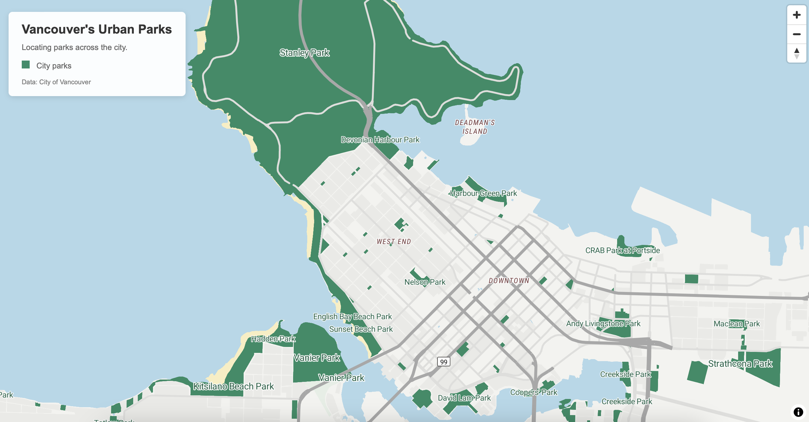

Reflective Analysis: The map I created explores the distribution of parks throughout the City of Vancouver. The intended audience for this map is Vancouver residents who are interested in accessing green spaces. The primary purpose of this map is to clearly illustrate where parks are located throughout the city in relation to the residential and urban landscape. I chose to represent parks in dark green, while surrounding urban areas, residential areas, and roads are shown in neutral grey. This creates contrast between parks and other features, allowing the parks to stand out as the focus of the map. Visually, I wanted to create a map that provided enough context for users to locate nearby parks without overcrowding it with unnecessary information. I think this was achieved by eliminating many of the original basemap layers that were not essential for users navigating to a park.

​I designed the park labels and specific map features to appear at different zoom levels. I created three park label layers so that larger parks would be labeled when the map was zoomed out, while smaller parks would be labeled as map users zoom in. I also adjusted the visibility of the roads and buildings at different zoom levels, allowing minor roads to become more prominent as users zoom in. My goal was to reduce clutter at smaller map scales so that the viewer would not be overwhelmed with too many labels or features.

I think something that could improve my map would be distinguishing between different types of parks. It could be interesting to include different colors or symbols depending on the amenities a park offers, such as sports fields, beaches or playgrounds. One other improvement would be to determine park label visibility based on popularity and not size. Some smaller parks may be popular but are harder to identify because their labels only appear when users zoom in closely. I read Jones's Cartographic Theory and Principles and found her discussion on “Simplicity and Sacrifice”(p.42) to be helpful in my map creation process. Jones emphasizes the importance of simplicity in cartography to avoid overwhelming users but also recognizing that too much simplicity can make a map less useful. I tried to keep this in mind when creating my map, as I wanted to provide enough geographic context for users to navigate to parks without including distracting elements that would take attention away from the map's primary purpose.

[View Interactive Map](https://jlenarci.github.io/Vancouver-Parks-Mao/)

Peer Feedbak and AI: ​I received peer feedback suggesting that the roads were too prominent and were drawing attention away from the park polygons. This feedback encouraged me to adjust the colors of the roads and their visibility at different zoom levels. I also used AI to help me with the map title as I was having difficulty formatting the title to be visually appealing.
